# Agent-to-agent handoff — testing document

What each hiring agent receives, what it produces, how its work reaches the next
agent, and what happens when an agent is switched off. Every row in the handoff
tables was run as an automated test, and each row says which test covers it.

- **Automated test:** [`scripts/agent-handoff.test.ts`](../scripts/agent-handoff.test.ts)
- **Last run:** 2 Nov 2026, on a new local database (`atsagent_handoff_test`, all 69 migrations): **49 / 49 passed**
- **Source of truth:** `src/server/agents/definitions.ts` (manifests),
  `src/server/agents/orchestrator.server.ts` (event → agent routing),
  `src/server/desk/desk.server.ts` (hiring-desk starts), `src/server/agents/policy.ts` (on/off switch)

```bash
set -a; source .env.local; set +a
export DATABASE_URL=${DATABASE_URL%/atsagent}/atsagent_handoff_test   # a throwaway DB
bun run db:migrate
HANDOFF_LEDGER=/tmp/handoff-ledger.json bun test scripts/agent-handoff.test.ts
```

`HANDOFF_LEDGER` is optional. When it is set, the test writes every handoff it
checked (edge, sender, event, receiver, subject and the data carried) to that
file, so the tables below can be compared with an actual run.

---

## 1. The agents

The app registers 21 agents: the **Copilot**, which turns a person's request
into work and starts specialists only after the person confirms, and the **20
specialist agents** below. Each organisation switches each agent on or off in
**Agent settings**. With no setting saved, an agent is off. There is also one
switch that turns off every agent in the organisation.

| #   | Agent                       | Type               | Owner           | Risk   | Who starts it                                                                   | Person decides (gate)                         |
| --- | --------------------------- | ------------------ | --------------- | ------ | ------------------------------------------------------------------------------- | --------------------------------------------- |
| 0   | Copilot                     | `copilot`          | HR head         | low    | A person, in chat                                                               | Confirms before any agent starts              |
| 1   | Requisition agent           | `requisition`      | HR head         | medium | Copilot / hiring desk                                                           | DH → HR head → CBO approve the requisition    |
| 2   | JD agent                    | `jd`               | Department head | low    | Requisition approved; DH sends JD back                                          | DH approves the JD                            |
| 3   | Publishing agent            | `publishing`       | HR head         | medium | JD approved on an approved role                                                 | HR head approves each job-board post          |
| 4   | Intake & matching agent     | `intake`           | HR head         | high   | Scheduler (new applicants, every 6 h); hiring desk once the JD is approved      | A person confirms rejections                  |
| 5   | Sourcing agent              | `sourcing`         | HR head         | medium | Scheduler (role has too few applicants)                                         | A person approves invitations                 |
| 6   | Distribution agent          | `distribution`     | HR head         | medium | JD approved; daily scheduler check                                              | HR head approves feed listings and CV erasure |
| 7   | Organisation context agent  | `org_context`      | HR head         | medium | Admin, from the org desk; monthly website re-read                               | HR head approves every profile version        |
| 8   | Role expert interview agent | `expert_interview` | HR head         | low    | Hiring desk (needs a hiring manager on the role)                                | HM approves the expert brief                  |
| 9   | Screening agent             | `screening`        | HR head         | medium | Shortlist; assessment completed; screening call ended                           | A person decides proceed / hold               |
| 10  | Screening call agent        | `screening_call`   | HR head         | high   | Screening agent's request, after a person approves                              | Call is approved before it is placed          |
| 11  | Follow-up agent             | `followup`         | HR head         | low    | Daily scheduler                                                                 | — (internal reminders only)                   |
| 12  | Interview coordinator       | `interview`        | HR head         | medium | Candidate advanced; no-show; panellist unavailable; times not picked            | HM / HR head approve panel and stand-ins      |
| 13  | Scheduling call agent       | `scheduling_call`  | HR head         | medium | Interview coordinator's request, after a person approves                        | Call is approved before it is placed          |
| 14  | L1 panel agent              | `panel_l1`         | HR head         | high   | L1 call transcript ready; panel review due                                      | HR head reviews any disagreement              |
| 15  | L2 panel agent              | `panel_l2`         | HR head         | high   | L2 call transcript ready; panel review due                                      | HR head reviews any disagreement              |
| 16  | L3 panel agent              | `panel_l3`         | HR head         | high   | L3 call transcript ready; panel review due                                      | HR head reviews any disagreement              |
| 17  | Evaluation agent            | `evaluation`       | Hiring manager  | high   | Scorecards submitted                                                            | HM makes the hiring decision                  |
| 18  | Negotiation call agent      | `negotiation_call` | HR head         | high   | Offer agent's request, after the HR head approves                               | A person confirms any verbal yes              |
| 19  | Offer agent                 | `offer`            | HR head         | high   | HM selects; pay form returned; negotiation outcome; offer sent back / countered | HR head → CBO approve; HR head releases       |
| 20  | Pre-onboarding & release    | `onboarding`       | HR head         | high   | Offer approved; document received / rejected                                    | HR validates documents and releases           |

No agent can approve, release, reject, hire, revoke, decline or accept. The
registry refuses any tool that tries. Agents can only `propose_`, `request_` or
`submit_`, and a person makes the decision.

---

## 2. If an agent is switched off partway through, can HR still finish?

**Yes.** Every agent is optional. An agent works on the same records and uses
the same server functions as the Manual-mode pages, so whatever an agent does,
a person can do on the matching page. The test checks this: section 6 switches
off each agent one at a time, and section 8 completes the hire with **every**
agent switched off.

### 2.1 What happens when an agent is off

1. **The event is still handled, and no run starts.** The orchestrator checks
   the agent's switch before every handoff (`loadPolicy(...).enabled`). When the
   agent is off, it posts a note in the role's hiring-desk thread and marks the
   event `done`. The event is not retried and does not get stuck. Tested in §6.
2. **The hiring desk tells HR what to do.** The note reads: _"The next step needs
   the … agent, which is switched off. Switch it on in Agent settings and I'll
   continue — or do this step yourself in Manual mode."_ Publishing, Follow-up
   and Sourcing have their own wording. Tested in §6.
3. **Runs already in progress wait.** A queued run of a switched-off agent is
   not picked up (`runAgentTick` only takes runs whose agent is on). It stays
   queued and continues if the agent is switched back on. Approval cards that
   are already open stay in "Waiting for you" and can still be decided.
4. **Missed events are not replayed.** An event that arrived while the agent
   was off has already been handled. Turning the agent back on restarts the
   step each hiring-desk thread is waiting for (`resumeThreadsForAgent`). It
   does not go back through old events. For example, an L2 call transcribed
   while the L2 panel agent was off is never assessed.
5. **Voice agents use a different switch.** The screening, scheduling and
   negotiation call agents start only when another agent requests a call. Those
   requests are refused with a stated reason when phone calls are switched off
   (Organisation → Phone calls). The agent that made the request then uses its
   written fallback: the e-mailed assessment, e-mailed time choices or the pay
   message. Tested in H26.

### 2.2 Worked example: the L2 panel agent switched off

The L2 panel agent sits silently on every L2 interview. Once the call is
transcribed, it records a hidden view of the candidate and e-mails the panel a
factual summary. After the panel has scored, its view is compared with theirs.
If they **disagree**, the candidate's move is put on hold for the HR head.

| Situation                                                                                          | What happens                                                                                                                                                                    | Test            |
| -------------------------------------------------------------------------------------------------- | ------------------------------------------------------------------------------------------------------------------------------------------------------------------------------- | --------------- |
| L2 agent off **before** the call                                                                   | The transcript event is handled but no panel run starts. No hidden view, no summary e-mail. Once the panel submits scorecards, the candidate moves as normal (`blocked = null`) | D1              |
| L2 agent was on and recorded a disagreeing view, then was switched **off** before the panel scored | The disagreement is recorded in `panel_assessments` (`held = false`) and audited, but **nothing is held**. The candidate moves on the panel's verdict                           | D2              |
| L2 agent **on** (for comparison)                                                                   | The same disagreement holds the move: _"On hold for the HR head…"_ (`movedTo = null`)                                                                                           | D3              |
| L1 and L3 agents                                                                                   | Work the same way at their own level. Each level has its own switch                                                                                                             | C (panel_l1/l3) |

In short, with the L2 agent off, the L2 round works exactly as it did before
panel agents were added. HR books the round (Interviews page, or the Interview
coordinator if it is on), the panel scores it in _My interviews_, and the
scorecards move the candidate. The only things lost are the independent second
opinion and the summary e-mail to the panel.

### 2.3 Manual fallback for every agent

| Agent                 | If it is off…                                                                                                       | HR completes the step by hand                                                                                                                                                        |
| --------------------- | ------------------------------------------------------------------------------------------------------------------- | ------------------------------------------------------------------------------------------------------------------------------------------------------------------------------------ |
| Copilot               | Chat requests are not turned into agent work                                                                        | Use the Hiring desk or Requisitions & JD directly                                                                                                                                    |
| Requisition           | No draft, no market pay research                                                                                    | **Requisitions & JD** → new requisition. The DH → HR head → CBO approval chain is the same                                                                                           |
| JD                    | No JD draft after approval or a send-back. Desk note posted (tested)                                                | **Requisitions & JD** → write the JD and submit it. The DH approves                                                                                                                  |
| Publishing            | Not posted. Desk note: _"post it yourself in Manual mode"_ (tested). Distribution still starts if it is on (tested) | **Internal postings**, **Job distribution**                                                                                                                                          |
| Intake & matching     | Applicants are not scored or shortlisted automatically (tested: scheduler starts nothing)                           | **JD ↔ CV matching**, **Talent pool** → move candidates to _Shortlisted_                                                                                                             |
| Sourcing              | Nobody watches roles with too few applicants (tested)                                                               | **Talent pool** search, add candidates to the pipeline                                                                                                                               |
| Distribution          | No portal listings or inflow checks (tested)                                                                        | **Job distribution**, **Careers inbox**                                                                                                                                              |
| Organisation context  | The profile is not built or re-read                                                                                 | **Organisation profile** page. Other agents use the last approved version                                                                                                            |
| Role expert interview | No expert brief. The desk says it is off (tested)                                                                   | Write screening questions and the interview plan rubric by hand (Screening, Interviews → plan)                                                                                       |
| Screening             | No kits, assessments or proceed/hold notes. Desk note posted (tested)                                               | **Screening calls** page, then move the candidate to L1 (a reason is needed if screening was skipped. Tested in §8)                                                                  |
| Screening call        | Requests are refused (tested). Screening sends the written assessment instead                                       | HR phones the candidate, or relies on the written assessment                                                                                                                         |
| Follow-up             | Overdue approvals, scorecards and interviews are not chased                                                         | "Waiting for you" and the dashboard                                                                                                                                                  |
| Interview coordinator | Rounds are not booked or rebooked. Desk note posted (tested)                                                        | **Interviews** → schedule the round (`scheduleInterviewCore`, the same function the agent uses. Tested in §8)                                                                        |
| Scheduling call       | Requests are refused (tested). The e-mailed time choices still work                                                 | HR agrees a time and books it on **Interviews**                                                                                                                                      |
| L1 / L2 / L3 panel    | No hidden view, no summary e-mail, nothing put on hold (tested D1–D3)                                               | No action needed. The panel's scorecards decide                                                                                                                                      |
| Evaluation            | No debrief and no hiring-decision request. Desk note posted (tested)                                                | The HM or HR head records the decision by moving the candidate to the offer stage (tested in §8)                                                                                     |
| Negotiation call      | Requests are refused (tested)                                                                                       | HR discusses pay with the candidate and records the agreed figure on the offer                                                                                                       |
| Offer                 | No draft, letter or approval request. Desk note posted (tested)                                                     | **Offers** → raise the offer, generate the letter, HR head → CBO, release. Letter generation is an AI feature, so it still needs the organisation's AI key even with every agent off |
| Pre-onboarding        | Documents are not chased or cross-checked. Desk note posted (tested)                                                | Candidate page → review documents (`reviewOnboardingDocCore`). HR releases                                                                                                           |

---

## 3. Handoff map

```mermaid
flowchart LR
  P((Person)) -->|confirms| CP[Copilot]
  CP -->|H0 start_agent| RQ[Requisition]
  RQ -.->|DH→HR→CBO approve| H1{{requisition approved}}
  H1 -->|H1| JD[JD]
  JD -.->|DH sends back| JD
  JD -.->|DH approves| H3{{jd.approved}}
  H3 -->|H3a| PB[Publishing]
  H3 -->|H3b| DS[Distribution]
  H3 -->|H3c desk| IN[Intake & matching]
  SCH((Scheduler)) -->|H25a new applicants| IN
  SCH -->|H25d too few applicants| SO[Sourcing]
  SCH -->|H25b daily| FU[Follow-up]
  SCH -->|H25c daily| DS
  SO -->|adds pool candidates| IN
  DS -->|portal CVs arrive| IN
  IN -->|H4 shortlisted| SC[Screening]
  SC -.->|request + approval| SCC[Screening call]
  SCC -->|H6 call ended| SC
  SC -->|H5 assessment done| SC
  SC -.->|person: proceed| H7{{advanced}}
  H7 -->|H7| IV[Interview coordinator]
  IV -->|H8–H11 no-show / stand-in / times| IV
  IV -.->|request + approval| SCL[Scheduling call]
  SCL -->|books offered time| IV
  IV -->|H12 transcript ready| PN[Panel L1/L2/L3]
  PN -->|H13 review due| PN
  PN -.->|people score| H14{{scorecard.submitted}}
  H14 -->|H14| EV[Evaluation]
  EV -.->|HM selects| OF[Offer]
  OF -->|H16 pay form back| OF
  OF -.->|request + HR approval| NC[Negotiation call]
  NC -->|H18 agreed| OF
  OF -->|H17, H19, H20| OF
  OF -.->|HR→CBO approve| H21{{offer approved}}
  H21 -->|H21| ON[Pre-onboarding]
  ON -->|H22, H23 documents| ON
  OC[Org context] -. approved profile .-> RQ & JD & SCC & NC
  EX[Role expert] -. expert brief .-> SC & IV & PN
  DESK((Hiring desk)) -->|H24| EX
```



Solid arrows are handoffs from the orchestrator, the hiring desk or the
scheduler. Dotted arrows are steps a person decides, or data that agents read
from the database.

---

## 4. Handoff table: what each agent passes to the next

Each row was run. "Data carried" is what the receiving agent gets in its run
goal (the text that starts the run). The test checks every string listed. For
each orchestrator handoff, the test also checks these fields on the new run:

| Field on the new run (`agent_runs`) | Expected value                                                                   |
| ----------------------------------- | -------------------------------------------------------------------------------- |
| `agent_type`                        | the receiving agent                                                              |
| `subject_type` / `subject_id`       | `requisition` + role id, or `application` + candidate application id (as listed) |
| `principal_user_id`                 | the person who raised the requisition (the run acts for them)                    |
| `trigger_event_id`                  | the event that caused the handoff                                                |
| `status`                            | `queued`                                                                         |
| goal ends with                      | `Requisition id: <id>`                                                           |
| the event                           | `status = done`                                                                  |

### 4.1 Event-driven handoffs (orchestrator)

| ID    | From (whose work produced it)            | Event                                   | To                    | Subject                     | Data carried to the next agent                                                                      | Result |
| ----- | ---------------------------------------- | --------------------------------------- | --------------------- | --------------------------- | --------------------------------------------------------------------------------------------------- | ------ |
| H1    | Requisition (after CBO approval)         | `requisition.status_changed` → approved | JD                    | requisition                 | Requisition code, title, "is approved", draft and get DH approval                                   | Pass   |
| H2    | JD (DH sends back)                       | `jd.changes_requested`                  | JD                    | requisition                 | **DH's comment word for word** ("Add on-call expectations"), revise and resubmit                    | Pass   |
| H3a   | JD (DH approves)                         | `jd.approved`                           | Publishing            | requisition                 | Publish internally, prepare external posts                                                          | Pass   |
| H3b   | JD (DH approves)                         | `jd.approved`                           | Distribution          | requisition                 | Advertise on job portals, route CVs back                                                            | Pass   |
| H3c   | JD (DH approves, role has a desk thread) | `jd.approved` → desk                    | Intake & matching     | requisition                 | Requisition code + title, linked to the desk thread                                                 | Pass   |
| H4    | Intake (or a person) shortlists          | `application.shortlisted`               | Screening             | requisition                 | Number of shortlisted candidates (ids in the event)                                                 | Pass   |
| H5    | Screening (assessment sent)              | `assessment.completed`                  | Screening             | application                 | Application id, **score (78/100)**, ask a person via `screening_decision`                           | Pass   |
| H6    | Screening call                           | `screening_call.ended`                  | Screening             | application                 | Application id, how the call ended (completed / reason)                                             | Pass   |
| H7    | Person decides "proceed"                 | `application.advanced`                  | Interview coordinator | application (one candidate) | Number advanced, book the next rounds                                                               | Pass   |
| H8    | Panellist can't attend                   | `interview.panellist_unavailable`       | Interview coordinator | application                 | Panellist name, memberId, level (L2), booked time, propose a stand-in                               | Pass   |
| H9    | Interview missed                         | `interview.missed`                      | Interview coordinator | application                 | Level, outcome ("candidate no show"), offer new times                                               | Pass   |
| H10   | Candidate rejected the offered times     | `interview.slots_unanswered`            | Interview coordinator | application                 | Level, why ("none of them work"), **candidate's note** ("Only evenings"), request a scheduling call | Pass   |
| H11   | Candidate didn't reply                   | `interview.slots_no_reply`              | Interview coordinator | application                 | Level, request a scheduling call                                                                    | Pass   |
| H12.1 | Interview call transcribed               | `interview.transcript_ready` (L1)       | L1 panel              | application                 | Interview id, "L1 interview round". Only the L1 agent starts                                        | Pass   |
| H12.2 | Interview call transcribed               | `interview.transcript_ready` (L2)       | **L2 panel**          | application                 | Interview id, "L2 interview round". Only the L2 agent starts                                        | Pass   |
| H12.3 | Interview call transcribed               | `interview.transcript_ready` (L3)       | L3 panel              | application                 | Interview id, "L3 interview round". Only the L3 agent starts                                        | Pass   |
| H13   | L2 panel's view disagrees                | `panel.review_due`                      | L2 panel              | application                 | Interview id, "disagrees with", ask the HR head (`request_panel_review`)                            | Pass   |
| H14   | Panel submitted final-round scorecards   | `scorecard.submitted`                   | Evaluation            | application                 | Application id, level (L3), round verdict (select), ask the HM for the decision                     | Pass   |
| H14b  | L2 round held by the panel agent         | `scorecard.submitted` (held)            | Evaluation            | application                 | "on hold", **write the debrief only, do not request a hiring decision**                             | Pass   |
| H15   | HM selects (after Evaluation)            | `hiring.selected`                       | Offer                 | application                 | Application id, prepare the offer within the approved band                                          | Pass   |
| H16   | Candidate returned the pay form          | `compensation.submitted`                | Offer                 | application                 | Expected CTC and notice period are in, continue the offer                                           | Pass   |
| H17   | Candidate countered the pay message      | `negotiation.needs_call`                | Offer                 | application                 | Negotiation id, why ("replied … with another figure"), may ask for a pay call                       | Pass   |
| H18   | Figure agreed (message or pay call)      | `negotiation.agreed`                    | Offer                 | application                 | Draft at the agreed figure, HR head and CBO approval                                                | Pass   |
| H19   | HR head / CBO send the offer back        | `offer.status_changed` → draft          | Offer                 | application                 | **Approver's reason word for word** ("Keep joining bonus under 1L")                                 | Pass   |
| H20   | Candidate asked for changes              | `offer.status_changed` → countered      | Offer                 | application                 | Candidate asked for changes, revise within the band                                                 | Pass   |
| H21   | CBO approves the offer                   | `offer.status_changed` → approved       | Pre-onboarding        | application                 | Offer approved, collect and cross-check documents                                                   | Pass   |
| H22   | Candidate uploaded a document            | `onboarding.document_received`          | Pre-onboarding        | application                 | A document arrived (only once an offer is approved)                                                 | Pass   |
| H23   | HR rejected a document                   | `onboarding.document_rejected`          | Pre-onboarding        | application                 | **Document type** ("relieving letter") and **HR's reason** ("Unsigned copy")                        | Pass   |
| —     | Any event, role on hold / closed         | e.g. `assessment.completed`             | none                  | —                           | Nothing starts. The event is still marked done                                                      | Pass   |

### 4.2 Handoffs started by an agent tool, the hiring desk or the scheduler

| ID   | From                          | How                                                                               | To                                                  | Subject         | Data carried                                                                    | Result |
| ---- | ----------------------------- | --------------------------------------------------------------------------------- | --------------------------------------------------- | --------------- | ------------------------------------------------------------------------------- | ------ |
| H0   | Copilot                       | `start_agent` tool (after the person confirms)                                    | Requisition                                         | none (new role) | The person's request with every detail ("2 backend engineers, Chennai, hybrid") | Pass   |
| H0b  | Copilot                       | `start_agent` for JD                                                              | JD                                                  | requisition     | Refused without a requisition id. With one, the id is passed on                 | Pass   |
| H24  | Hiring desk (HR)              | "Interview the hiring manager"                                                    | Role expert interview                               | requisition     | Code + title, desk thread. Needs a hiring manager on the role                   | Pass   |
| H25a | Scheduler                     | New applicants in the last 2 h                                                    | Intake & matching                                   | requisition     | Number of new applications **and their channels** ("careers_page")              | Pass   |
| H25b | Scheduler                     | Daily                                                                             | Follow-up                                           | none            | Fixed goal: find overdue items, remind the right people                         | Pass   |
| H25c | Scheduler                     | Daily                                                                             | Distribution                                        | none            | Fixed goal: portal inflow, quiet listings, inbox, CV erasure                    | Pass   |
| H25d | Scheduler                     | Role has too few applicants                                                       | Sourcing                                            | requisition     | Code + title, "needs more candidates"                                           | Pass   |
| H26  | Screening / Interview / Offer | `request_screening_call` / `request_scheduling_call` / `request_negotiation_call` | Screening call / Scheduling call / Negotiation call | application     | Refused with the reason when phone calls are off                                | Pass   |

---

## 5. What each agent reads and writes

"Reads" is the data the agent's tools can see. "Writes" is what it changes in
the app. "External" is anything sent outside the app. "Hands to" is how its
output reaches the next agent. All of this comes from the manifests in
`definitions.ts`.

| Agent                    | Reads (input)                                                                                                  | Writes (output)                                                                   | External                                                              | Hands to                                                                     |
| ------------------------ | -------------------------------------------------------------------------------------------------------------- | --------------------------------------------------------------------------------- | --------------------------------------------------------------------- | ---------------------------------------------------------------------------- |
| Copilot                  | Requisitions, departments                                                                                      | Agent runs it starts                                                              | —                                                                     | Requisition, JD, Publishing, Distribution, Intake, Screening (`start_agent`) |
| Requisition              | Requisitions, departments, live market pay                                                                     | Draft requisition, pay band + budget, scoring weights, submission for approval    | —                                                                     | Approvers. Once approved → JD (H1)                                           |
| JD                       | Requisition, JD versions, the organisation's JD template                                                       | New JD version submitted for review                                               | —                                                                     | DH. Approved → Publishing, Distribution, Intake (H3). Sent back → JD (H2)    |
| Publishing               | Requisition, approved JD, publishing channels                                                                  | Internal job posting flag                                                         | Job-board posts (HR head approves)                                    | Applicants arrive → Intake (H25a)                                            |
| Intake & matching        | Applications, match scores, CV summaries, talent pool                                                          | Scores, moves to shortlisted / on hold / reserve, pool candidates added, notes    | —                                                                     | Shortlist → Screening (H4). Rejections → a person                            |
| Sourcing                 | Requisitions, applications by source, talent pool, past candidates, channels                                   | Pool candidates added to the pipeline                                             | Invitations to apply (approved)                                       | New applications → Intake                                                    |
| Distribution             | Where each role is advertised, applications by source, inbox imports, channel history, CVs limited to one role | Feed listings (approved), roles to post by hand, CV erasure (approved), reminders | Job feeds (Jooble, Adzuna, Jora)                                      | Portal CVs → Intake                                                          |
| Organisation context     | Organisation record, its own website, uploaded documents, admin chat                                           | Draft profile versions and their sources                                          | —                                                                     | Approved profile, read by Requisition, JD, the call agents and others        |
| Role expert interview    | Requisition, JD, interview plan, the HM and their answers                                                      | Expert brief + interview-plan rubric (once the HM approves)                       | —                                                                     | Brief, read by Screening, the Interview coordinator and the panels           |
| Screening                | Shortlisted applications, kits, call and assessment results                                                    | Screening kits, assessments, notes                                                | Assessment invites and reminders, pay form, AI screening call request | Screening call (by request). A person proceeds → Interview coordinator (H7)  |
| Screening call           | Role facts, contact, screening kit (one call)                                                                  | Consent (in the candidate's words), answers, details stated, an agreed time       | One call; confirmation e-mail                                         | `screening_call.ended` → Screening (H6)                                      |
| Follow-up                | Pending approvals, JD reviews, open agent requests, members                                                    | Internal reminder e-mails                                                         | —                                                                     | People only                                                                  |
| Interview coordinator    | Applications and rounds, members, meeting tools, free/busy                                                     | Interview rounds, stage set to the booked round                                   | Time choices, invites, meeting links, scheduling-call request         | Scheduling call (by request). Transcript → Panel (H12)                       |
| Scheduling call          | The e-mailed offer of times, pre-checked alternatives (one call)                                               | Go-ahead, chosen time (booked through the offer), call-back, AI-call opt-out      | One call; invitations once booked                                     | The booked round. A transcript later → Panel (H12)                           |
| L1 / L2 / L3 panel       | That level's rounds: candidate, role, competencies, panel. Transcript (inside its tools only)                  | Its hidden assessment of the round                                                | Factual summary e-mail to the panel                                   | People score → Evaluation (H14). A disagreement → itself → HR head (H13)     |
| Evaluation               | Match, screening, assessment, every scorecard, selection parity                                                | Debrief note                                                                      | —                                                                     | HM decides → `hiring.selected` → Offer (H15)                                 |
| Negotiation call         | The approved proposal, one improved figure, extras (never the ceiling or band), profile facts, JD              | Go-ahead, the candidate's position, a verbal yes for a person to confirm, opt-out | One call                                                              | `negotiation.agreed` → Offer (H18)                                           |
| Offer                    | Compensation, band and budget, hiring decision, recent offers, market pay                                      | Draft offer, letter, submission for approval                                      | Pay form, pay message (HR approves), pay-call request                 | Approvers. Approved → Pre-onboarding (H21)                                   |
| Pre-onboarding & release | Documents and what was extracted from them, the offer, pay evidence                                            | — (reads and requests only)                                                       | Document-request e-mails                                              | HR validates and releases                                                    |

### 5.1 Voice agents: what goes into a call and what comes back

| Call agent       | Requested by (tool)                              | Who approves | Data given to the call                                                                               | What comes back                                                           | Next                                                   |
| ---------------- | ------------------------------------------------ | ------------ | ---------------------------------------------------------------------------------------------------- | ------------------------------------------------------------------------- | ------------------------------------------------------ |
| Screening call   | Screening, `request_screening_call`              | A person     | `loadBriefFacts`: organisation, role, contact, kit questions, calling window, reschedules left       | Consent, answers (graded), details stated, an agreed time                 | `screening_call.ended` → Screening (H6)                |
| Scheduling call  | Interview coordinator, `request_scheduling_call` | A person     | `SchedulingBrief`: facts, numbered time options, the slot offer, candidate                           | The chosen time (booked through the same offer), availability, opt-out    | The booked round                                       |
| Negotiation call | Offer, `request_negotiation_call`                | HR head      | `NegotiationBrief`: proposal, one improved figure, extras, the approved brief. **Never the ceiling** | The candidate's position, a verbal yes (a person confirms it), call notes | `negotiation.agreed` / `needs_call` → Offer (H17, H18) |

---

## 6. Test results: one agent switched off

For each case the test turns that agent off, sends the event that would hand
work to it, and checks four things: **no run started**, **event `done`**,
**orchestrator failures = 0**, and **a desk note saying "switched off" and
"Manual mode"**. It then turns the agent back on.

| Agent off                                 | Event sent                        | Run started?                        | Event | Desk note                         | Result |
| ----------------------------------------- | --------------------------------- | ----------------------------------- | ----- | --------------------------------- | ------ |
| JD                                        | `jd.changes_requested`            | No                                  | done  | Yes                               | Pass   |
| Screening                                 | `application.shortlisted`         | No                                  | done  | Yes                               | Pass   |
| Interview coordinator                     | `application.advanced`            | No                                  | done  | Yes                               | Pass   |
| L1 panel                                  | `interview.transcript_ready` L1   | No                                  | done  | Yes                               | Pass   |
| **L2 panel**                              | `interview.transcript_ready` L2   | No                                  | done  | Yes                               | Pass   |
| L3 panel                                  | `interview.transcript_ready` L3   | No                                  | done  | Yes                               | Pass   |
| Evaluation                                | `scorecard.submitted`             | No                                  | done  | Yes                               | Pass   |
| Offer                                     | `hiring.selected`                 | No                                  | done  | Yes                               | Pass   |
| Pre-onboarding                            | `offer.status_changed` → approved | No                                  | done  | Yes                               | Pass   |
| Publishing                                | `jd.approved`                     | Publishing no, **Distribution yes** | done  | "post it yourself in Manual mode" | Pass   |
| Role expert interview                     | desk "interview the HM"           | No (returns null)                   | —     | Yes                               | Pass   |
| Intake, Follow-up, Distribution, Sourcing | scheduler sweep                   | None of them                        | —     | —                                 | Pass   |

## 7. Test results: L2 panel agent (section D of the test)

| ID  | Setup                                                                 | Expected                                                             | Result |
| --- | --------------------------------------------------------------------- | -------------------------------------------------------------------- | ------ |
| D1  | L2 agent off, transcript arrives, panel scores "select"               | No panel run, `blocked = null`, candidate moves, no panel comparison | Pass   |
| D2  | L2 agent off after it recorded a "reject" view, panel scores "select" | Comparison `disagree` recorded, `held = false`, candidate moves      | Pass   |
| D3  | L2 agent on, same disagreement                                        | `movedTo = null`, "On hold for the HR head"                          | Pass   |

## 8. Test results: every agent off, HR completes the pipeline by hand

The organisation-wide switch is off, and every step is done with the same
server functions the Manual-mode pages call:

| Step                  | Done by hand with                                                                             | Outcome                                                           |
| --------------------- | --------------------------------------------------------------------------------------------- | ----------------------------------------------------------------- |
| Applied → Shortlisted | `moveStageCore` (Talent pool / candidate page)                                                | Moved                                                             |
| Shortlisted → L1      | `moveStageCore` with the reason "Screened by phone by HR" (needed when screening was skipped) | Moved                                                             |
| Book L1, L2, L3       | `scheduleInterviewCore` (Interviews page)                                                     | Booked                                                            |
| Score L1, L2, L3      | `submitScorecardCore` (My interviews)                                                         | L1 → l2, L2 → l3, L3 complete and waiting for the hiring decision |
| Hiring decision       | `moveStageCore` L3 → offer pending, reason "Selected by the hiring manager"                   | Offer pipeline                                                    |
| Agent activity        | `processAgentEvents` after all steps                                                          | **0 agent runs**. Every event emitted is `done`                   |

**Not covered by this test:** the offer → release → onboarding steps done by
hand. They use `createOfferCore`, `generateOfferLetterCore`, `advanceOfferCore`
and `reviewOnboardingDocCore`, which the agent tools also call, and
`agent-phase4.test.ts` and `agent-hiring-cost-offer.test.ts` already test them.
The offer letter is written by the AI gateway, so it needs the organisation's AI
key even when every agent is off.

---

## 9. Checking handoffs in the app by hand

Use a test organisation. Turn on the agents you want to check in **Agent
settings**, then for each handoff:

1. Do the step that produces the event. For example, approve the JD as the DH
   on **Requisitions & JD**.
2. Open **Agent activity**. A new run of the receiving agent should appear. Its
   first message is the goal. Check that it contains the data in the
   "Data carried" column of §4.
3. Open the run to see its steps. The tool calls show what it read (input) and
   what it wrote or asked for (output). Approval cards appear in **Waiting for
   you**.
4. Switch the receiving agent off and repeat step 1 on another candidate or
   role. No run should appear, and the role's **Hiring desk** thread should say
   the agent is off and suggest Manual mode.

| What to check                             | Where in the app                                                                   |
| ----------------------------------------- | ---------------------------------------------------------------------------------- |
| Input (goal and data carried)             | Agent activity → the run → first message                                           |
| Output (records written, messages queued) | The run's steps, then the record itself (requisition, candidate, interview, offer) |
| Decisions waiting for a person            | Waiting for you                                                                    |
| Agent off / manual step                   | Hiring desk thread for the role                                                    |
| Cost and AI calls of the run              | Agent observability, Hiring cost                                                   |

## 10. Limits of this test

- The model is not called. Handoffs are checked when the next run is created,
  which is where all the data passed between agents is. How each agent behaves
  inside its run (its tools and decisions) is covered by
  `agent-phase1…4.test.ts`, `agent-sourcing.test.ts`,
  `distribution-agent.test.ts`, `panel-*.test.ts` and the real-agent evals in
  `scripts/evals/scenarios.ts`.
- Voice calls are only tested at the request step (refused while phone calls
  are off). The calls themselves are covered by the voice simulations in
  `scripts/evals/` and the voice tests.
- The Organisation context agent's monthly re-read is not part of the scheduler
  test. It needs a saved website and an approved profile version.
